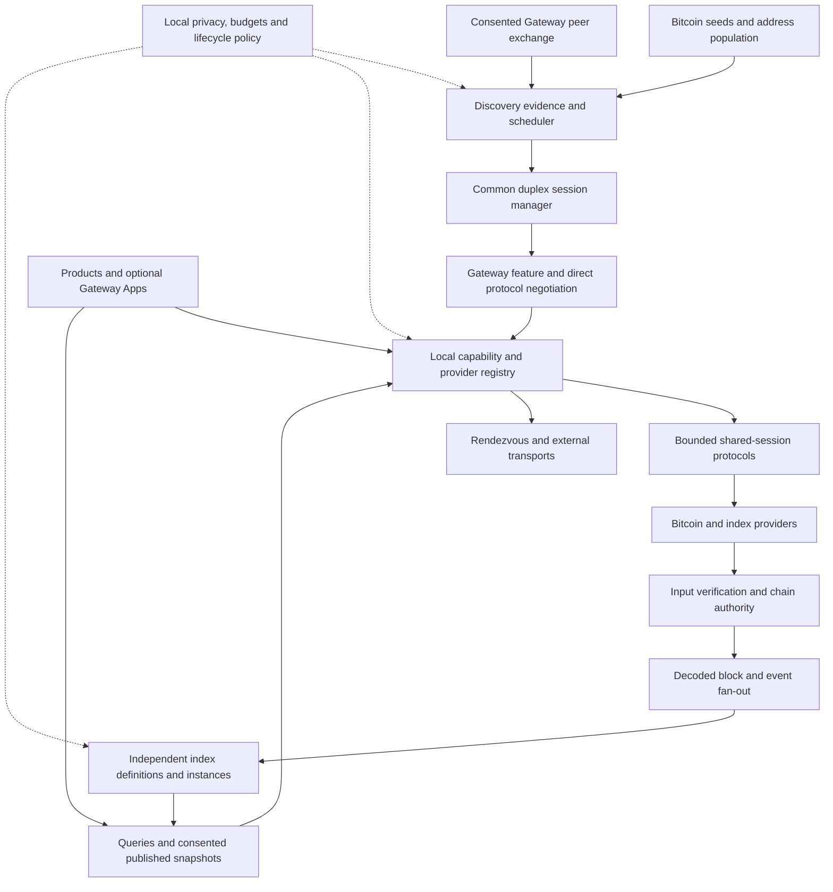

# Gateway architecture audit and implementation plan

**Follow-up:** This is the preserved baseline audit. The subsequently authorized fixes and current validation are recorded in [the audit repair candidate](discovery-repair-candidate.md); findings below describe the audited source, not an assertion that every defect remains in the repair build.

**Date:** 26 September 2026. **Source:** `5acabb0ac27c6bcd9786b65a43236dd2962982b8` (v0.5.4). **Repository head reviewed:** `7f2ce1b9d39f2105c7ba0f116d5cd9925f0d2ff2`, whose only change is the audit brief. **Disposition:** audit and design; production source unchanged. This report evaluates the brief rather than adopting its architectural assertions as requirements already proved.

The core direction is sound: discover compatible peers, keep useful relationships alive, and allow applications and indexes to choose their own data and retention models. The current implementation does not yet establish that architecture operationally. First contact is conditional, sessions are asymmetric, some privacy boundaries leak through derived state, and negative index answers need stronger completeness guarantees.

Keep these two principles, with their operational conditions explicit:

> Gateway should decouple what a node can answer from what it must permanently store. An answer still needs available inputs, valid dependencies and a declared verification basis.
>
> Bitcoin can introduce Gateway where truthful Bitcoin-serving Gateway endpoints propagate. Once connected, Gateway should maintain a small diverse mesh and help applications find the peers they need.

## Decisions

1. **Keep one Gateway feature and a small direct-support hello.** BIP 434 plus hello demonstrates current protocol behavior, not identity or correctness. Do not assign a Bitcoin feature bit or BIP 434 feature ID to every application.
2. **Do not promise universal Bitcoin-only first contact.** Stock Core filters out bit-25-only address gossip. The existing Core-backed archival Gateway listener is a plausible entrance participant; a sparse or receive-only Gateway is not equivalently propagatable. Verify that deployment before optimizing its crawler.
3. **Repair the session floor before adding protocols.** A common duplex session, protocol-specific response correlation, typed service selection and renewable resource budgets are prerequisites. Existing automatic Bitcoin pool replenishment works in a controlled fixture; replace the narrower defects rather than inventing another connection manager.
4. **Make discovery pursue Gateway membership separately from BOD availability.** Preserve compatible empty peers. Prefer known compatible endpoints during recovery. Add bounded, consented Gateway peer exchange as a separate protocol only after stability and stock-Core propagation tests.
5. **Fix index privacy and absence semantics before generalizing indexes.** Private source data does not automatically authorize public derived hints. Missing/corrupt index storage must yield unknown, never a stronger absence claim.
6. **Build one concrete stateless index before a universal framework.** TRIP is useful vocabulary, not a reason to implement a generic execution engine, Merkle network, plugin sandbox and app store together. Bitmap needs an explicit Ord compatibility profile and reproducible corpus before it can be a proof of correctness.

## Scope and evidence

The complete Git tree (195 files, including assets) was retrieved through the authenticated GitHub connector and every blob checked against its Git SHA. The checkout's root tree and head commit were reconstructed and matched exactly after local Git credentials proved expired. The parent/head comparison confirms the source is the brief's pinned baseline. Generated tooling, binaries, research scratch and temporary profiles are outside the production diff.

Review covered networking/discovery and their tests, protocol specifications, provider/index/Ord/Satline paths, local APIs/UI, persistence, setup, cleanup, packaging and verification history. This is a risk-focused architecture audit, not a claim that every possible behavior or every source line received exhaustive security verification.

Evidence levels used below:

- **Reproduced:** an isolated test exercised baseline behavior on native Windows in this audit. Bug-reproduction tests deliberately assert the existing defect; their passing result does not mean the defect is fixed.
- **Source:** a reachable code path establishes the concern, without an end-to-end exploit or load test.
- **Historical:** reported by repository QA documents, not newly observed here.
- **Proposed:** design or acceptance work, not implemented or passed.

The [verification record](audits/2026-09-26/verification.md) records commands, failures, skips, fixture boundaries and retained reproductions. The [Bitcoin discovery study](audits/2026-09-26/bitcoin-discovery.md), [networking analysis](audits/2026-09-26/network-floor.md) and [apps/index analysis](audits/2026-09-26/index-apps.md) provide detailed evidence. The historical v0.5.4 Linux report explicitly reports **no public connection established** and **no stock-Core propagation or native Windows installer execution**. The later two-machine Windows observations are LAN QA, not proof of unknown public discovery. Do not combine these into a public-network success claim.

## A. Current architecture and responsibility boundaries

| Component | Current ownership and behavior | Boundary or duplication |
|---|---|---|
| Runtime and setup | `main.go`, `runtime.go`, `config.go`, `setup_051.go`, `activation.go`; settings, background services, local management and lifecycle | Single large application object coordinates most services; keep this composition root while extracting ownership gradually |
| Bitcoin session manager | `network_051.go`, `network_052.go`; outbound sessions, read/write/request queues, pool maintenance, health and data selection | Inbound listener in `overlay.go` is separate; ownership and counters disagree |
| Bitcoin discovery | `p2p.go`, `address_wire_052.go`, `bitcoin_discovery_serving_052.go`; DNS seeds, addr/addrv2, getaddr, truthful serving readiness and announcements | Advertising a packet, propagating an endpoint and proving reachability are distinct |
| Discovery evidence | `discovery_ledger_053.go`, `discovery_persistence_053.go`; canonical endpoints, direct/gossip evidence, committed attempts, quotas and recovery | Exact retained records live in RAM as well as the journal; working-set bounds are not total-memory bounds |
| Discovery policy | `discovery_scheduler_053.go`, `discovery_quality_054.go`, `discovery_advertisement_054.go`; six evidence/retry buckets, role rotation, network/source caps and endpoint election | BOD usefulness drives crawler mode; no source-yield learning or dedicated known-member recovery lane |
| Gateway negotiation | `gateway.go`, BIP 434 code in `p2p.go`; one feature, 16 KiB hello and directly listed families | BOD built in, Satline opt-in; protocol list is not a dynamic app registry |
| BOD | `overlay.go`, `bod_status.go`, `network_051.go`, `spec/bod-protocol.md`; locators, status, block transfer and optional Core data | Inbound/outbound serving implementations differ; generic ServeData includes expensive operations |
| Bitcoin verification/providers | `headers*.go`, `chain_authority.go`, `integrity.go`, `block.go`, `core*.go`; header authority, commitment checks, Core RPC/mounts and retrieval | Header anchoring is not full Bitcoin script/UTXO consensus validation; locators remain claims until checked |
| Retained derived data | `cache.go`, `graph.go`, `coverage.go`, `txresolve.go`; cache knowledge, transaction/spend records, sparse coverage and graph scans | Raw data can be discarded while derived state remains; visibility and shard integrity do not consistently follow that state |
| Satline and Ord | `satline*.go`, `ord.go`, `ord_envelope.go`; trace/cache/publication and known-inscription envelope extraction | Satline has useful explicit publication patterns; current Ord is not a complete historical Ord index |
| Modules and UI | `extension.go`, `MODULE-API-v1.txt`, `gateway_shell.go`, `web.go`, `ui/*`, `browser-companion/*` | Manifests describe modules, but do not register executable handlers; BOD extension metadata bypasses manifest advertisement consent |
| Persistence/cleanup/distribution | `storage.go`, `migration.go`, `durable_*.go`, `internal/cleanup/*`, `packaging/*`, `scripts/*` | Preserve reviewed deletion, ownership and external-provider guards. Windows link-privilege and fixed-port test assumptions need explicit gates |

Preserve the exact evidence ledger, separated direct/gossip service observations, commit-before-dial history, conservative block integrity checks, explicit Satline publication, local API origin checks and cleanup ownership model. Remove duplicate ownership and stale interfaces after repairs, not by a broad rewrite during the repair release.

## B. Networking diagnosis and smallest safe repair

| Finding | Evidence and trigger | Recommended repair |
|---|---|---|
| **P1: request timeout destroys responsive transport** | Reproduced. `network_051.go:436–479` closes the session when request context expires; fixture withholds headers while successfully answering ping | Separate request failure from liveness failure; correlate or quarantine late replies before permitting reuse |
| **P1: negotiated inbound sockets cannot originate managed requests** | Reproduced. `overlay.go:268–496` owns inbound sockets; `network_051.go:614–621` routes through `n.sessions`. Fixture sees one live Gateway but zero managed/BOD-available sessions | Transfer reader/writer ownership once after hello into the same session registry; never run two readers on one socket |
| **P1: rejected header batches leave changed chain files on Windows** | Reproduced by the existing rollback test and isolated OS fixture. `headers_051.go:406` opens append-only; truncation at 419/426 fails with access denied and is ignored. File grows from 80 to 160 bytes while the operation returns the original count and an error | Use a rollback-capable handle or staged transaction; check rollback/sync errors and keep persisted chain, returned count and published status consistent |
| **P2: valid long-lived sessions exhaust lifetime counters** | Reproduced for BOD: request 65 closes the connection. `overlay.go:454–456`, `network_052.go:683–686`; Satline has analogous cumulative limits | Use per-protocol renewable token budgets, bounded concurrency/bytes and explicit busy responses; retain hard framing limits |
| **P2: receive-only Gateway selection and serving behavior disagree** | Reproduced. `network_051.go:640–656` can select a non-Bitcoin-serving member for headers; `network_052.go:660–669` silently drops BOD with serving disabled, unlike inbound unsupported response | Select by required Bitcoin/provider capabilities; distinguish speaking BOD from offering data; answer supported control requests with explicit availability |
| **P2: membership does not satisfy discovery** | Source. `network_052.go:155–160,208–225` requires BOD plus request success to reduce search; known negotiated endpoints share hint retry queues | Separate member target, service demand and exploration policy; service failure need not expel a healthy member |
| **P2: history capacity suppresses known-member repair** | Source. intake exhaustion makes `seek=false` at `network_052.go:209`; scheduler suppresses candidate/search roles at `discovery_scheduler_053.go:108` | Separate new-record intake quota from reconnect eligibility for retained records; retain bounded journal headroom and explicit storage-error handling |

The diagnosis that the pool lacks automatic replenishment is too broad. `network_051.go:216–239` already runs maintenance each second. A controlled six-peer fixture replenished the three ordinary slots after individual and multiple losses without Retry. This establishes the mechanism under eligible available replacements, not public availability or timing. Timeout teardown, cooldowns, unsuitable session selection and divergent inventories are more specific repair targets.

The Windows rollback failure leaves a **validated prefix** of a rejected batch in the selected file. It demonstrates broken batch atomicity and state/count consistency, not acceptance of the invalid second header. Include native file-handle semantics in the repair gate; Linux success does not cover this behavior.

**Late-reply safety is the difficult part.** Removing `s.close()` alone is unsafe. BOD and Satline responses have IDs and can use bounded pending maps plus expired-ID tombstones. Bitcoin block replies can be matched to the requested block hash, including typed notfound handling. `headers` responses have no request ID: keep a serialized lane with a bounded quarantine/drain policy, or replace the transport when ambiguity cannot safely be resolved. An observed pong does not correlate a previous header response. Do not allow request A's late response to satisfy request B.

Use one lifecycle: TCP connected -> Bitcoin negotiated -> Gateway feature agreed -> compatible hello completed -> active protocols. Record local and remote support separately; changes require an agreed refresh mechanism or reconnect. Close once with typed reasons. Derive all live UI counts from that registry; retain historical evidence in the ledger. Inbound source ports are session addresses, not automatically dialable listening endpoints.

The smallest acceptance demonstration is two isolated Windows instances with ordinary Bitcoin retrieval deliberately disabled for the BOD test: each initiates a non-genesis request over the **same** negotiated connection; a delayed/missing response does not corrupt the next response; more than 64 valid requests remain usable; ordinary Bitcoin pool maintenance continues independently. The result must identify actual transport, peer, request ID, bytes and verification result. A fallback response from another source cannot pass that test.

## C. Bitcoin entrance and heat-seeking discovery

### What the external protocol permits

The [independent study](audits/2026-09-26/bitcoin-discovery.md) pins Core v31.1 to `9be056a8a72b624dae9623b2f7bded92c2a21c91`. Its shared addr/addrv2 receive path requires useful Bitcoin service flags before addrman admission/relay; bit 25 alone and bit 25 plus WITNESS alone do not qualify. NETWORK or LIMITED can satisfy that part of admission, but must describe real service. Relay, retention and selection then have additional conditions. [Core receive path](https://github.com/bitcoin/bitcoin/blob/9be056a8a72b624dae9623b2f7bded92c2a21c91/src/net_processing.cpp#L4028-L4115), [service definitions](https://github.com/bitcoin/bitcoin/blob/9be056a8a72b624dae9623b2f7bded92c2a21c91/src/protocol.h#L308-L363).

`getaddr` has no service filter. Core responds to inbound connections once per connection, with at most 1,000 addresses/23% of addrman; ordinary replies are cached for roughly 21–27 hours. **Correction from the follow-up review:** the inbound cache key uses the requester's network class and Core's local listening IP/port, not the requester's keyed network group. Many IPv4 clients reaching the same Core listener can therefore share one cached sample. Reconnecting is not necessarily a new sample. Addrman records are an address population, not the answering node's current neighbors. [Core getaddr](https://github.com/bitcoin/bitcoin/blob/9be056a8a72b624dae9623b2f7bded92c2a21c91/src/net_processing.cpp#L4904-L4937), [response cache](https://github.com/bitcoin/bitcoin/blob/9be056a8a72b624dae9623b2f7bded92c2a21c91/src/net.cpp#L3716-L3762), [inbound cache-key construction](https://github.com/bitcoin/bitcoin/blob/9be056a8a72b624dae9623b2f7bded92c2a21c91/src/net.cpp#L1836-L1850), [addrman sampling](https://github.com/bitcoin/bitcoin/blob/9be056a8a72b624dae9623b2f7bded92c2a21c91/src/addrman.cpp#L812-L850).

Unknown experimental flags are not automatically erased, but neither are they an authenticated or exclusive Gateway identifier. Core unions gossip masks: even an observed precise mask may reflect prior combined claims. Keep exact received masks and direct version evidence separate. A copied claim from several suppliers is not several independent proofs. [Core addrman admission](https://github.com/bitcoin/bitcoin/blob/9be056a8a72b624dae9623b2f7bded92c2a21c91/src/addrman.cpp#L550-L623).

Core v31.1 advertises 70016. BIP 434 requires >=70017 and forbids feature messages to older peers; its merge on Core master is not release deployment evidence. Gateway can still find addresses through an ordinary older Core and negotiate directly with a Gateway implementation at the eligible version. [Core release version](https://github.com/bitcoin/bitcoin/blob/9be056a8a72b624dae9623b2f7bded92c2a21c91/src/node/protocol_version.h#L9-L12), [BIP 434](https://github.com/bitcoin/bips/blob/b14d7c34e5ffa4dd910eeba3df4f92af6a9609d4/bip-0434.md#L75-L178).

### The first-contact deployment must be explicit

The existing adapter advertises NETWORK only after checking a synchronized, unpruned mainnet Core provider (`bitcoin_discovery_serving_052.go:56–169`). This is coherent if **Gateway's own advertised listener** actually supplies the promised Bitcoin service. An attached Core's separate 8333 listener does not automatically advertise or implement Gateway's listener. Sparse Gateway/BOD storage is not archival Bitcoin service. Recent-block LIMITED support would require a real implementation and acceptance tests, not another constant in the mask.

Track seven separate observations: announcement written; recipient wire acceptance; addrman admission; relay; seeker learning; externally reachable advertised port; successful Gateway negotiation. The current code can show only portions of this chain. Outgoing IP observations and a successful local bind do not prove NAT/firewall reachability. A finite isolated public population with no acceptable reachable entrance participant has **zero** discoverability by any amount of crawling; general public first-contact time has no finite bound.

The narrow additional mechanism is a population of independently operated, truthful Bitcoin-serving Gateway endpoints, followed by peer exchange after first contact. No hard-coded Gateway authority is required. Optional manual/invite/recovered hints remain useful recovery inputs, but must be labelled separately from the zero-known-endpoint Bitcoin-only proof. If stock propagation is too sparse in practice, change the claimed bootstrap guarantee instead of spoofing Bitcoin services.

### A bounded convergence algorithm

Retain existing default ceilings initially: three ordinary Bitcoin slots, two retained Gateway slots, two exploration slots, three concurrent dials and one new token per five seconds (`network_052.go:22–23`). Compare alternatives at equal budgets before tuning them.

1. Separate **cold entrance**, **mesh repair**, **healthy mesh**, and **service search**. Maintain ordinary Bitcoin transport as needed for Bitcoin work. Gateway mesh health depends on compatible live sessions and diversity, not block inventory.
2. Prefer directly compatible saved endpoints in a reserved repair lane, with age, bounded exponential backoff and direct re-verification. A prior endpoint is not a trust authority or durable identity. A privacy-preserving installation may choose not to persist it.
3. Next prioritize recent direct hints, then specific third-party hints. Keep weak/all-bits and unbiased exploration shares so lying precise hints cannot monopolize search. Start with explicit configurable quotas, not an opaque learned score.
4. Measure introducer novelty and downstream **direct compatibility yield per dial/time cost**, with decay, minimum samples and capped influence. Credit an endpoint once; do not reward repeated gossip or repeated claims. This is a testable scheduling heuristic, not a graph-distance estimator.
5. Enforce diversity across the entire reserved mesh and candidate pool, not only within each role. IPv4 /16 and IPv6 /32 heuristics limit concentration but are not identities or complete anti-Sybil protection. DNS aliases and multi-port variants need dial-budget accounting.
6. Keep negative compatibility evidence separate from transport reachability failures, retaining the current independent cooldown. Expire evidence deliberately because endpoints change software; a negative result is not permanent truth.
7. When the mesh is healthy, reduce wide Bitcoin exploration substantially and satisfy app-specific demand independently. After loss, repair known peers and bounded peer-exchange candidates first, then widen Bitcoin exploration. Keep a small independent exploration floor to avoid permanent eclipse.

The current six buckets correctly improve fairness and limit all-bits noise, but do not strictly prioritize old compatible peers, score introducers or globally optimize convergence. Static first-source caps also should not be mistaken for independent source reputation. `DISCOVERY-LEDGER-v1.md` still describes four 1,024-entry buckets; code uses six floors of 4,096/6 (maximum 4,092 eligible queued entries). Correct the documentation.

**Bounded exact history requires an explicit tradeoff.** Current quotas keep admission finite and honestly count unretained observations, but all retained rows remain in memory and cold floods can fill the quota. Rebuilding six queues scans the ledger under its mutex; persistence/compaction and full export also hold it. Keep correctness, instrument contention and resume time, then add incremental due queues only if measurements justify them. Separate new-intake exhaustion from retained-peer repair. Reserve a small bounded capacity for trusted-local configuration and previously negotiated evidence without permitting unlimited history writes. A deliberate archive/retention policy can preserve an exact external history while keeping active evidence bounded; discarding active records must stop claiming lifetime-perfect deduplication.

Compare current and proposed policies across many seeded mixed/adversarial populations. Report median/p95 time and dials to first/N compatible sessions, failures by deadline, repeated-attempt ratio, per-source novelty, false-positive rate, concentration, bytes, peak memory, journal growth and mesh-recovery latency. Include globally mixed address populations where no useful gradient exists. Stock-Core filtering/cache experiments precede public convergence claims.

## D. Root protocol and migration

Keep `one Gateway BIP 434 feature -> Gateway hello -> direct protocol families`. IDs remain opaque stable machine identifiers; versions have protocol-defined compatibility. BOD support does not mean blocks exist, and protocol negotiation does not verify a claim. Root Gateway should not parse game messages, index rule logic, Nostr events or BitTorrent pieces.

No Gateway wire-v1 change is needed for session ownership, scheduler repairs, honest counters or local app registration. Keep the 16 KiB limit; validate duplicate IDs, version counts, string lengths, hello sequencing and protocol intersection. Fail a malformed/incompatible negotiation explicitly. Do not silently truncate a large protocol inventory and advertise an incomplete list as complete.

Add a separately negotiated **peer-exchange family** and later, if necessary, a **capability-query family**. Old peers ignore families they do not support. A small hello advertises the query family; bounded queries answer specific protocol IDs with opaque cursors. Realm membership is scoped query output, never a global hello dump. Additive JSON fields require both old-parser and new-parser tests; changing the meaning/completeness of hello needs an explicit extension/version, not optimism about unknown-field tolerance.

Peer exchange should initially return a small capped set (for example 16 endpoints), normalized network/transport/address, observation age and optional claimed family; require owner publication consent, local TTLs, per-source quotas and private-address filtering. Do not exchange encounter history. Never dial before rechecking destination policy. Treat every result as an untrusted introduction and require direct negotiation. A stable cryptographic identity is unnecessary for the first public endpoint-hint experiment; it becomes relevant for authenticated realms, durable reputation or signed manifests and introduces key recovery/rotation and privacy costs. Signing does not establish index truth or defeat Sybils by itself.

Use additive ledger fields with honest unknown defaults; never synthesize old per-claim provenance. Back up/migrate atomically when format semantics change. Old binaries must not silently consume a schema they cannot represent. Separate index definition versions and storage schemas so old/new definitions can coexist, and never compare roots across different rule or dependency identities.

## E. App/provider and peerhood contract

The existing manifests are descriptive discovery, not a general runtime registration API. Introduce an authenticated local registry with leases; start with trusted bundled modules and one mock external process. Validate registrations, namespaces, handler reachability, resource quotas and consent before advertising. Expired/crashed providers withdraw availability.

A minimal protocol registration contains app/provider ID, protocol ID, supported versions, handler/IPC endpoint, permitted transports, data-plane mode, active lease and publication policy. Keep required/optional **local** host capabilities separate from **remote** capabilities offered. Do not publish local IPC paths, Core RPC settings, installed-but-inactive apps, private memberships or query interests.

A minimal peerhood selector is `(protocol ID, acceptable versions, optional opaque realm selector, realm-schema version)`, evaluated within a declared network/transport and privacy context. Realm selectors are protocol-defined, bounded, and can be invite-scoped; a hash of a guessable name is not secrecy. Peerhoods identify participating contexts; an index definition identifies computation. Neither should inherit the other's lifecycle by default.

Offer the smallest conceptual operations: register/withdraw, find/watch compatible peers with bounded updates, open a session or request rendezvous, and inspect evidence. Return claims, observations, negotiated compatibility and successful request evidence distinctly. Gateway owns connection health/routing/quotas; the application owns payload semantics, authentication and data validation. External endpoints need allowlists or scoped capabilities so a registration cannot become an arbitrary local-network dial proxy.

Registration metadata alone cannot route unknown app payloads through today's hard-coded BOD/Satline handlers. Add an explicit provider dispatcher and session binding. Prove the first external app through rendezvous; shared opaque application traffic needs a separately negotiated bounded carrier with protocol demultiplexing, cancellation and per-provider quotas.

Use a per-protocol hybrid:

| Example | Gateway's role | Data path |
|---|---|---|
| Small chat/control | Discover compatible context and manage session | Bounded multiplexed messages after duplex repair; app authentication/encryption defined separately |
| WebRTC/game/media | Authorized signaling and rendezvous | External media/data channel; STUN/TURN/relay availability is an additional requirement, not solved by hello |
| BitTorrent | Introduce participants in an explicitly scoped swarm | BitTorrent transfer and validation |
| Nostr | Locate an explicitly supported relay/peer context | Nostr transport and semantics; proxy only if a separately consented service offers it |
| Tor | Reachability/transport choice | Requires an actual Tor transport integration; recognizing an addrv2 address is not transport support |

Gateway Apps can later distribute adapters and metadata. Distribution, signature/trust policy and a browsing UI remain optional layers. A store must not become the authority that makes a protocol ID valid.

## F. TRIP and the smallest useful index model

**Theory** explains purpose. **Rule Set** defines deterministic computation. **Index** is an output instance under those rules and declared inputs. **Product** queries it and may add user policy without modifying its rule identity.

An **Index Definition** should be a canonical versioned document containing stable definition ID, theory reference, rule identity/hash, network constraints, input/dependency definitions, admissible initial states, transition and output schemas, canonical encoding, checkpoint format, verification scheme, range semantics and compatibility profile. Hash the normative machine-readable definition and rules artifact; a hash of prose alone does not make an executable rule set unambiguous. Explanatory theory URLs and display labels remain non-normative metadata unless deliberately made identity-affecting.

An **Index Instance** references that definition and records covered intervals/gaps, chain anchor, input/checkpoint provenance, dependency instances and their fingerprints, output commitments, completeness/verification status, locally queryable data, explicitly remotely serveable data and retention policy. Availability can change without changing rule identity. Snapshot output and serving metadata must not be confused.

Proposed range commitment, with versioned canonical length-delimited encoding and domain separation:

```text
SHA256("gateway.index.range.v1" || encode(
  definition_digest, rule_digest, network_identity,
  range_convention, start_height, end_height, parent_and_end_chain_anchors,
  starting_state_digest, input_commitment, ordered_dependency_commitments,
  output_schema_and_encoding_version, output_record_count, canonical_output_digest,
  resulting_state_digest, coverage_and_completeness_claim
))
```

Declare inclusive/exclusive endpoints, empty ranges, ordering, integer representation, duplicate handling, hash byte order and reorg semantics. An end-chain hash can commit to ancestors only within a validated chain context. A checkpoint's semantic digest covers the computational state/schema and chain binding. Store provenance and verification receipts alongside it; source identity, download time, local paths and mutable trust/availability labels stay outside the semantic fingerprint. Coverage/completeness here means a precisely enumerated committed claim, not a mutable local verification label. Rebuilding from an unverified peer checkpoint remains an explicitly checkpoint-trusted result. Matching roots prove byte agreement under declarations, not correct computation or consensus by majority.

| Index | Arbitrary-range semantics |
|---|---|
| Transaction locations; output/event occurrence | Usually range-local over verified blocks; claim only occurrences in those ranges |
| Address activity including spent inputs | Output creation can be range-local; resolving inputs to addresses needs prior transaction/script data or an explicit dependency |
| Spender occurrences | Scan any range for positive spend events; absence for an output requires complete valid coverage from creation through the selected snapshot |
| Current UTXO/address state | Genesis or a sufficiently verified UTXO checkpoint plus every transition |
| Absolute sat assignment/current sat location | Correct sat/UTXO ancestry and ordered transitions or a compatible checkpoint; selected blocks alone are insufficient |
| Ord eligibility, numbering and ownership | Exact Ord profile determines historical dependencies; extracting envelopes is a weaker, separately named index |
| Bitmap results | Depends on declared inscription eligibility/order and claim rules; ownership products require additional location/transfer dependencies |

Current address-to-UTXO state and historical address activity must be different definitions. Keep transaction locator/body, positive spender/complete spend history, sat current location/lineage and inscription occurrence/full Ord state similarly distinct.

The existing graph is a concrete starting point, but needs fail-closed shard integrity/completeness and publication policy. Corrupt or missing spend records currently collapse into not-found while coverage markers remain (`graph.go:490–593,731–732`). A marker proves an earlier write sequence, not that every required record remains readable today. Add per-range/shard integrity manifests or equivalent validated storage accounting, and invalidate affected completeness after damage. Test rollback after reorg; no orphaned data may support a current negative claim.

Feed one decoded verified block/event batch into independently versioned consumers. Give each consumer bounded backpressure and an atomic progress checkpoint; a slow/failing optional indexer cannot silently move another indexer's checkpoint or cause unbounded memory. Define deterministic replay, idempotence and reorg rollback before parallel fan-out. Reuse decoding in memory without forcing consumers to share an on-disk schema.

For peer serving, begin with one concrete index family and a small shared descriptor/envelope rather than a universal query language. Advertise definition, network, exact bounded ranges/gaps, anchor, query types, limits, commitment scheme and evidence level. Fetch richer metadata on demand. Positive locators can be checked against underlying blocks; negative answers need complete verified coverage. A Merkle inclusion proof proves inclusion relative to a root, not root correctness or absence of omitted history. Add hierarchical commitments only when range comparison/repair measurements justify them.

Retention is explicit: raw Bitcoin bytes, decoded events, checkpoints, derived outputs and published snapshots each have separate policies. Before deleting inputs, verify completed progress and a recoverable checkpoint, record the remaining rebuild dependency and respect independent publication consent. Remote availability is opportunistic unless a specific provider contract proves otherwise. “Can rebuild” needs a viable block locator/provider path, not merely the idea that Bitcoin exists somewhere.

## G. Bitmap proof architecture

Do not implement Bitmap by treating the current Ord extractor as complete historical Ord. `ord.go:154–179` explicitly refuses some context-dependent historical bindings. That caution is correct and should become typed dependency status, not a hidden shortcut.

Define the intended output first: original district claim, currently controlling inscription/location, or a product's eligible trading inventory. These require different data. Pin a Bitmap base-rule artifact and an Ord interpretation profile with activation heights, eligibility, ordering, encoding and duplicate/reinscription treatment. The original author's prose establishes intent but does not resolve every historical parser and numbering edge case. Unresolved normative choices are an explicit specification decision and corpus gate, not permission for the audit to invent consensus.

A complete claim build requires all eligible claim events under that profile in canonical order, including any prior state needed to determine eligibility. A compact compatible Ord checkpoint may replace full replay; it must include the particular UTXO/sat/inscription/counter/history state that the chosen rules actually consume. There is no universal “minimum Ord state” independent of the selected output and rules. Witness-only occurrence indexing can be a useful precursor, but cannot be relabelled full Ord correctness. Current ownership needs further spend/location tracking. Non-Bitmap inscriptions can affect later eligibility and must not be discarded before relevant state transitions; full media, explorer tables and all-sat inventory are not inherently necessary when the selected rules do not consume them.

Pipeline: acquire anchored blocks -> extract deterministic events -> apply declared Ord dependency -> run Bitmap base rules -> write outputs/checkpoints/range commitments -> verify fixtures/replay -> optionally discard source/intermediate bytes. Never assume the first Bitmap-relevant height is a sufficient starting state. Keep the ability to fetch evidence and rebuild selected ranges under declared dependencies.

Compatibility validators are separate namespaced rule/profile versions, never patches to base output. A disagreement record binds resource/district, competing inscription IDs, base result, compatibility result, responsible rule, source provenance, chain anchor and affected range commitments. Examples such as negative numbering or reinscription disputes belong in tests only once tied to an identified profile and historical evidence. A product can select a compatibility view while still exposing the base result and its version.

The proof corpus must include valid first claims, duplicates, invalid encodings, context-dependent Ord eligibility, reorgs and at least one documented base/compatibility disagreement. Pin expected canonical outputs and provenance. Synthetic disagreement proves isolation of validators; historical correctness needs independently sourced cases as well. See the [index study](audits/2026-09-26/index-apps.md) for primary-source limits.

## H. Security and privacy priorities

| Priority | Concrete exposure / trust failure | Required boundary |
|---|---|---|
| P1 | **Reproduced:** `cache.go:159–184` forwards verified private blocks into a visibility-free graph; `overlay.go:672–678` serves that graph before private-aware cache fallback; `bod_status.go:173–174` advertises its coverage | Carry publication policy into derived instances or keep a separate explicit published snapshot. Private fetching must not silently publish graph hints/coverage |
| P1 | **Reproduced:** deleting, truncating or CRC-corrupting spend records produces an unspent claim through surviving coverage markers | Distinguish not-found, incomplete and damaged; verify coverage integrity before negatives |
| P1 | Generic `ServeData` exposes Core `scantxoutset start` via `address_utxos` (`overlay.go:690–695`, `core.go:418–445`) | Default-off expensive remote capability, bounded jobs/rate/concurrency, cancellation and no implicit upstream amplification |
| P1 | Pre-negotiation and unknown commands can allocate up to global 32 MiB; listener allows 64 connections (`p2p.go:533–548`, `overlay.go:285`) | Command- and phase-specific limits before allocation, aggregate receive-memory budget, bounded handshake concurrency and read deadlines; theoretical aggregate is about 2 GiB, not an executed load result |
| P2 | **Reproduced:** `bod_status.go:145–153` publishes protocol metadata for manifests without checking `network_advertised`, active state or a real handler | Only registered, active, consented capabilities may leave the host; installation is not protocol support |
| P2 | Ord content origin grants wildcard CORS and reads cached known IDs (`ord.go:376–399`) | Explicit publication or unguessable scoped preview capability; hostile-origin tests. Port discovery/browser restrictions affect exploitability, not the need for a policy |
| P2 | Address floods exhaust exact-history intake and can suppress mesh recovery | Per-source/global admission budgets, reserved repair capacity, bounded retention and explicit degraded state |
| P2 | Precise bit lies, copied IDs, poisoned peer exchange and many IP identities | Diverse capped trials, negative evidence, direct verification and protocol-specific answer checks; identity signatures alone are insufficient |

Keep management loopback/Host/Origin checks, bounded request bodies and private diagnostic exports. Review custom skins as trusted management code, not as a sandbox for untrusted apps. Core credentials and provider filesystem paths remain local; provider labels sent on wire should be sanitized. Public index coverage, query history, peerhood membership and source-introduction history need independent consent decisions. Bitcoin P2P v1 traffic is not encrypted; private realms require an authenticated encrypted application/transport design.

Test revocation as well as consent: withdrawing a provider or switching privacy policy must stop future publication and prevent old snapshots from being silently re-offered. It cannot erase information already disclosed. Bound parser size, list length, realm selector size, concurrent operations, response bytes and per-provider CPU work separately.

## I. Target component model



The root process remains the composition and policy owner. Protocol handlers own semantics behind narrow interfaces; the session manager owns socket I/O, liveness and delivery. Discovery owns evidence and scheduling, never truth about application data. Index engines own reproducible state and rollback; publication adapters expose only consented instances. An app store has no place in the bootstrap or correctness trust chain.

## J. Staged implementation and release gates

The order below is a recommendation, not authorization to start production changes. Every stage should be independently reviewable and reversible. Fix the P1 privacy/absence/resource issues as small hardening changes alongside the floor, before advertising broader trust or index guarantees.

| Stage | Components/files and deliverable | Wire/migration risk | Required proof | Rollback and deferred work |
|---|---|---|---|---|
| 1. Networking floor, 0.5.4.1 | `network_051/052`, `overlay`, `p2p`, `headers_051`, network UI; common sessions, correlation, Windows header rollback, typed selection, renewable budgets, explicit BOD-only action | v1 unchanged; state/counter migration small; late-reply handling is highest risk | Symmetric requests, delayed replies, rejected/cancelled header batch atomicity on Windows/Linux, >64 requests, pool replacement, idle/soak, source-pinned BOD receipt | Small commits/release flag; no index framework, new peer exchange or marketplace |
| 1a. Correctness/privacy hardening, 0.5.x | `graph`, `cache`, `bod_status`, `ord`, `core`; fail-closed absence, derived publication, expensive-operation/framing budgets | Stricter serving may reduce visible capabilities; corrupt graph must be invalidated/rebuilt, not trusted | Damaged-shard unknown, private-fetch no public hints, consent revocation, bounded allocation/jobs | Preserve files and read-only diagnostics; disable unsafe capability if migration uncertain |
| 2. Discovery convergence, 0.5.x | scheduler/ledger/quality/advertisement; explicit mesh states, saved-member lane, intake/repair separation, source-yield metrics; optional peer-exchange family | Additive ledger provenance with unknown defaults; new separately negotiated family only after entrance gate | Stock-Core filter/propagation, equal-budget scheduler comparisons, mesh loss/restart/eclipsing hints | Keep baseline scheduler selectable and ledger readable; defer scoring complexity if no measured win |
| 3. Local capability/peerhood API | `extension`, `gateway`, module docs, local API; lease/consent registry and mock app | Local API version/capabilities; no change to v1 hello meaning; external transport optional | App-defined realm, handler withdrawal, external mock transport, old-client negotiation, privacy limits | Bundled registration adapter remains fallback; no arbitrary downloaded code execution |
| 4. Minimal index contracts | graph/coverage/storage plus small definition/instance types; canonical encoding, checkpoints, visibility, corruption/reorg semantics | Separate schema/definition IDs; never mutate old definition identity | Stateless/stateful range fingerprints, sparse coverage, interrupted rebuild, negative completeness | Preserve old data read-only; rebuild a new instance; defer universal query/VM/Merkle machinery |
| 5. Bitcoin-native indexes | Concrete transaction locator and spender-event index first; current UTXO/history only with explicit dependencies | Family-specific query versions; old BOD remains available | Independent same-input replay, positive Bitcoin evidence, absence only over verified complete coverage | Disable new provider and retain old instance; no generic address-history claims |
| 6. Ord | `ord*`, event consumers; named historical interpretation profile and provenance corpus | New dependency/definition identities; content preview remains separate | Historical profile fixtures, checkpoint replay equivalence, activation/reorg tests | Separate instance/profile; retain current honest envelope extractor |
| 7. Bitmap | New module consuming the proven Ord profile, base and compatibility instances | New family/definitions; product policies do not change base roots | Known claims and disputes, selective retention/rebuild, deterministic comparison | Withdraw module/instance without altering Gateway or Ord; no marketplace dependence |
| 8. External apps | One small chat and one rendezvous-only mock/real app, after floor | Separate app families/transports | Payload opacity, quotas, authenticated realm and external transport handoff | Remove provider registration; preserve core functionality |
| 9. Gateway Apps, only if justified | Optional distribution metadata/trust/browse product | No protocol-ID authority; signatures cover artifacts only | Install/withdraw and permissions with core usable absent directory | Entire directory can be removed; discovery and indexes continue |

Do not collapse stages 4–7 into a promise to ship all of Ord and Bitmap in 0.5.x. Ship the networking, evidence and concrete correctness proofs first. Semantic module work should earn its release scope through corpus results.

## Ten proof tests and their present status

| # | Required test | Status and pass condition |
|---|---|---|
| 1 | Bitcoin-only entrance | **Not proved.** Existing ordinary-peer fixtures are not stock Core; historical public probe failed. Require unknown truthful participant introduced only through stock Bitcoin address exchange, retained duplex session and independently checked reachability |
| 2 | Heat-seeking under noise | Existing fairness/noisy-graph fixtures support mechanics, not superiority. Proposed equal-budget multi-seed trials must include no-gradient and adversarial cases and failed runs |
| 3 | Mesh recovery | Ordinary pool replenishment reproduced; Gateway mesh recovery remains incomplete. Remove all members, repair saved/exchanged candidates within bounds, then widen fallback; repeat at full ledger quota |
| 4 | Symmetric session | **Baseline defect reproduced.** Same TCP session must accept independently initiated requests both ways with late replies and healthy long-duration traffic |
| 5 | App-defined peerhood | Proposed. Mock provider registers protocol+realm, finds a compatible peer, withdraws on lease expiry; root never interprets payload |
| 6 | Discovery-only external transport | Proposed. Rendezvous returns a scoped endpoint/token; separate mock data connection carries data; closing it does not falsely remove Gateway membership |
| 7 | Deterministic stateless range | Proposed formal definition proof. Independent builds compare canonical outputs/root across order/restart/chunk sizes and after raw-block deletion |
| 8 | Stateful range | Proposed. Different valid starting checkpoints produce distinct commitments; incompatible or unverified dependencies cannot be labelled equivalent/fully verified |
| 9 | Sparse coverage | Existing interval mechanics are a start. Formal instance must answer A/C, report gap B, reject unsupported negatives and invalidate coverage on corruption/reorg |
| 10 | Bitmap disagreement | Proposed after profile/corpus selection. Base output/root stays unchanged when a namespaced validator disagrees; retained evidence identifies both rules and affected inscriptions/ranges |

Add repair gates outside those ten: private-derived-index publication, module consent, damaged-shard absence, bounded unauthenticated allocations and expensive Core work. These protect the very trust and retention model the architecture is intended to expose.

## Direct answers to all 18 questions

1. **Is bit-25 Bitcoin discovery viable?** Conditionally, for reachable Gateway endpoints whose truthful Bitcoin services allow propagation. It is not a universal standalone mechanism for bit-only Gateway listeners and has not passed the required stock/public test here.
2. **Hard Core limits?** Service/routability/retention filtering; random bounded cached addrman samples; limited relay; no service-filtered getaddr; unauthenticated/unioned masks; version boundary; externally reachable endpoints required. Absence from the observable population cannot be solved by scheduling.
3. **Strongest practical heat-seeker?** Diversity-preserving evidence tiers, reserved known-compatible repair, bounded precise/weak/unbiased trials, durable negative evidence and measured decaying source yield. Do not infer topology from getaddr or promise a convergence advantage before comparison.
4. **Bounded peer exchange?** Yes after session stability, as a separate consented family returning expiring hints requiring direct verification. Keep independent Bitcoin fallback and a small exploration floor.
5. **What should Gateway know?** IDs/versions, scoped peerhood selectors, reachability, transport mode, leases/consent, resource requirements and evidence. Payload semantics, application truth and product policy remain with providers/apps.
6. **Control or data plane?** A control/discovery substrate with a per-protocol choice of bounded shared-session traffic or external data transport.
7. **Minimal peerhood descriptor?** Protocol ID, compatible versions, optional opaque realm selector with its schema, plus network/transport/privacy context. It is not an index instance or an exposed global member list.
8. **Wire-v1 changes?** None for floor/ledger/local registry fixes. Add peer exchange/query as separately negotiated families; semantic hello changes require explicit negotiation/versioning. Preserve old-client interoperability.
9. **Module evolution?** Replace descriptive-manifest-as-capability assumptions with authenticated local registration, active handler leases, withdrawal, quotas and explicit publication; bundle adapters first.
10. **Definition vs instance?** Immutable canonical computational recipe/version vs node-built anchored coverage/state/dependencies/evidence/availability/retention. Store both explicitly and allow different instances of one definition.
11. **Range fingerprint inputs?** Definition/rules, network, range convention/bounds, chain anchor, starting state, dependency commitments, canonical output schema/digest, resulting state and completeness. Matching hashes do not independently prove truth.
12. **Arbitrary ranges?** Positive event/location indexes can often start anywhere with correct inputs. UTXO/sat/current ownership and historical Ord state need genesis or compatible prior state; negative spender claims require complete post-creation coverage; input-address history needs prevout dependencies.
13. **Minimum upstream Bitmap state?** Depends on exact Bitmap output and Ord profile. Complete ordered eligible claim events plus required eligibility history/checkpoint; current ownership adds transfer/location state. Current envelope parsing is insufficient. Define and test the profile before claiming a minimal checkpoint.
14. **Base and historical interpretations?** Separate immutable base definition and namespaced compatibility validators/instances; disagreements are evidence with provenance and never mutation of base rules.
15. **0.5.x vs later?** Floor, truthful discovery/metrics, privacy/corruption fixes and a small registry/concrete index experiment fit. Full historical Ord, Bitmap guarantees and Gateway Apps wait for proven dependencies and explicit scope.
16. **Remove/simplify?** Duplicate inbound/outbound I/O ownership and serving paths; BOD-dependent membership logic; runtime access to legacy direct-dial fallbacks once replaced; dead helpers such as `resolveSpenderViaOverlay`; stale BOD feature/module docs; avoid expanding version-suffixed files indefinitely. Preserve tests and wire behavior through the consolidation.
17. **Largest risks?** False absence from damaged coverage, private derived-data publication, unauthenticated allocation/expensive provider amplification, eclipsing/ledger exhaustion, copied protocol IDs and stale or poisoned service/index claims. Local preview/query privacy and credential isolation also need explicit tests.
18. **Smallest next implementation?** A narrow session repair with symmetric retained requests, safe timeout correlation, Windows header-batch rollback, renewable request budgets, honest capability selection/counters and a BOD-only receipt; accompany it with the concrete privacy/absence guards. Then run the stock-Core entrance experiment before increasing architecture breadth.

## Recommended next work order

Implement stage 1 as the next focused repair, using the reproduced defects as inverted regression tests and the existing replenishment fixture as a behavior to preserve. Ship no “public discovery solved” claim with it. In parallel or immediately afterward, close the P1 publication/absence/resource holes in narrowly scoped commits. The next architectural investment is a measured stock-Core entrance trial and saved-member recovery, not a marketplace or a full generic index engine.
